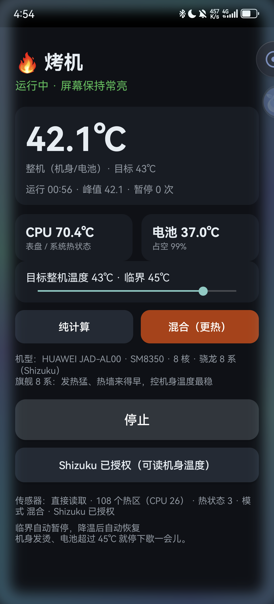

# 烤机 BurnIn — Android 热压力测试应用

用多线程满载把手机 SoC 烤热，按**机身温度闭环**自动调负载，到临界温度自动暂停、降温后恢复，并带独立看门狗急停。

> ⚠️ **免责声明**：本应用通过持续制造 CPU 高负载加热设备，可能导致机身发烫、烫伤、电池加速老化、系统卡顿或关机，极端情况下损坏硬件。请勿在无人看管、床上或易燃物附近使用。使用风险自负，作者不承担任何责任。应用首次启动会显示完整免责声明，需同意后才能使用。



## 功能

- **三种负载**：纯计算 / 混合（计算 + 内存带宽，明显更热）/ **激进升温**（独立按钮，强制混合 + 线程超订 1.5 倍 + 占空 100%）
- **机型自适应**：通过 Shizuku `getprop`（回退 `Build.*` / `/proc/cpuinfo`）识别 SoC，套用不同默认目标温度与内存负载
- **闭环控温**：控温对象是机身壳温 shell_*，PI 调节占空比
- **临界暂停**：整机到 `目标+2℃`（最高 62℃）、电池 45℃、CPU 表盘 102℃、系统热状态 ≥5 时停负载，降温自动恢复
- **看门狗**：独立线程每 0.5 秒复查，越过红线直接结束
- **前台服务 + WakeLock**：退到后台不被冻结，通知栏显示实时温度并带「停止」按钮
- **Shizuku**：以 shell 身份读热区温度（普通 App 被 SELinux 限制时兜底）

## 为什么不用 CPU 表盘控温

很多骁龙机型的 `cpu-*-step/usr` 是**瞬时结温估计**：只要有一个核在跑，读数立刻跳到 95℃（系统温控上限），负载一停又秒回 60℃。它跟功率绑定、不跟热量走，拿它做闭环只会疯狂启停。真正缓慢累积、代表"烤热了没有"的是机身壳温和电池温度，所以用它控温，CPU 表盘只做急停保险。

## 机型策略

| 平台 | 识别关键字 | 默认目标 | 滑块上限 | 内存负载 |
|---|---|---|---|---|
| 骁龙 8 系 | SM8450 / SM8550 / SM8650 / SM8350 / lahaina / taro / kalama / crow / pineapple | 43℃ | 60℃ | 1M float |
| 骁龙 7/6 系 | SM7xxx / SM6xxx | 42℃ | 60℃ | 600K |
| 天玑 | MTxxxx | 42℃ | 60℃ | 600K |
| 麒麟 | Kirin / hi3xxx | 41℃ | 60℃ | 500K |
| 通用 | 其他 | 42℃ | 60℃ | 600K |

临界值与急停值随目标自动上移（目标 +2 / +4，最高 62 / 64℃），目标 ≥48℃ 时开始前会二次确认。

## 下载安装

### 方式一：直接下载 APK（推荐）

到 [Releases](https://github.com/doglngqianqiu/burnin-app/releases) 下载最新的 `burnin.apk`，
在手机上允许「安装未知应用」后安装即可。

- 包名 `com.dsh.burnin`，minSdk 26（Android 8+），targetSdk 31
- 用的是调试签名，首次安装会提示「未知来源」；Play Protect 可能提示风险，选择仍要安装
- 装新版前若签名变化，需要先卸载旧版

### 方式二：自己编译

克隆仓库后按下面的「构建」一节操作，产物在 `dist/burnin.apk`。

## 构建

需要 `aapt`、`zipalign`、`apksigner`、JDK 17+（Debian/Ubuntu 可直接 apt 安装），以及 `curl`、`unzip`。

```bash
scripts/fetch-deps.sh    # 下载 android.jar (platform-31) 和 r8.jar
./build.sh               # 产物在 dist/burnin.apk
adb install -r dist/burnin.apk
```

构建脚本不依赖 Gradle：`aapt` 打包资源 → `javac` 编译 → `d8` 转 dex → `zipalign` → `apksigner` 签名（首次运行自动生成调试签名）。

`sdk/shizuku/` 下是 [Shizuku](https://github.com/RikkaApps/Shizuku) 的 API/provider/aidl/shared classes.jar（Apache-2.0），用于 shell 权限读取。

## 使用

1. 打开应用，阅读并同意免责声明
2. 首次使用点「授权 Shizuku」→ 始终允许（不授权也能跑，只是读不到机身温度，只能靠电池温度）
3. 选模式（纯计算 / 混合），拖滑块设目标温度（38–60℃）
4. 点「开始烤机」，屏幕保持常亮；结束点「停止」
5. 结束后静置 10 分钟散热，再充电

## 实测（HUAWEI JAD-AL00 / SM8350 / 8 核）

| 模式 | 每线程占用 | 开跑 56 秒 CPU 表盘 | 大核频率 |
|---|---|---|---|
| 纯计算 | ~70%（整机 664%） | 59–60℃ | 1.2 GHz |
| 混合 | 68–73% | 70.4℃ | 1.49 GHz |

系统曾把大核压到 1.2–1.4 GHz（电池 40%、热状态 3），所以升温偏慢；凉机、满电、关闭省电模式时会更明显。

## 目录

```
app/                 Android 工程（Java，无 Gradle）
  src/com/dsh/burnin MainActivity / BurnService / Engine / Sensors / DeviceProfile
  src/rikka/shizuku  ShizukuShell（shell 执行封装）
build.sh             手工构建脚本
scripts/fetch-deps.sh 下载 android.jar / r8.jar
docs/screenshot.png  运行截图
```

## 许可证

MIT（见 LICENSE）。Shizuku 组件遵循 Apache-2.0。
